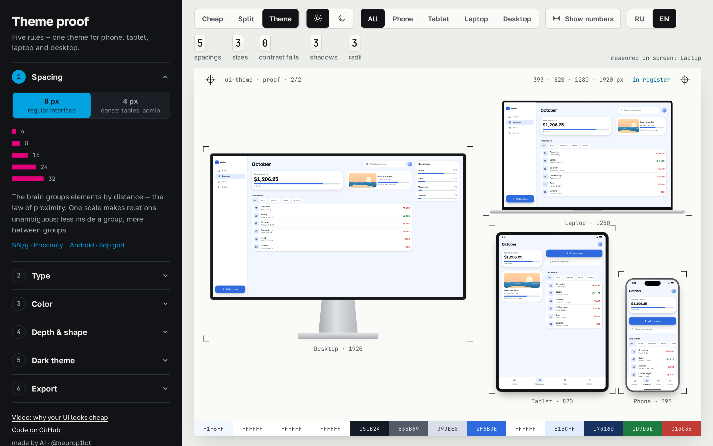
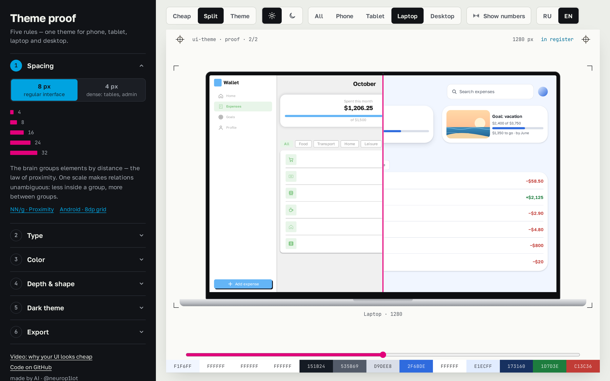

# ui-theme — Theme proof / Оттиск темы

**Open the tool:** https://arthurkrantsevich.github.io/ui-theme/ · RU / EN · free, runs in the browser

One UI theme from **five rules** — spacing, type, color, depth, shape — checked on the same app on **phone, tablet, laptop and desktop at once**, in light and dark. Export it as CSS variables, a Tailwind v4 `@theme` block or JSON tokens.

Made for the video «Интерфейс выглядит дёшево? 5 правил, которые это чинят» on [@NeuroP1lot](https://www.youtube.com/@NeuroP1lot). Made by AI.



## Build your theme in 6 steps

1. **Spacing.** Pick the base step: **8 px** for a regular interface, **4 px** for dense ones (tables, admin). You get one scale: 4 · 8 · 16 · 24 · 32. Use less inside a group, more between groups, and make buttons at least 44 px.
2. **Type.** Body size (16 px is the browser default) and the scale step: **×1.25** for apps, **×1.333** for landings with big headings. You get three sizes: caption, text, heading. The heading grows with the screen through `clamp()`.
3. **Color.** Paste your brand color. Every role (background, surface, text, accent, error…) is built from it, and **every text/background pair is checked against WCAG 4.5:1**. If white text on your brand color fails, **Fix** picks the nearest darker shade that passes.
4. **Depth & shape.** Shadow softness and corner roundness. You get three elevation levels, and nested corners are computed for you (inner radius = outer − padding).
5. **Dark theme.** Built from the same roles: dark-grey background instead of black, a lighter accent, and lighter surfaces for higher layers.
6. **Export.** Copy CSS, Tailwind v4 or JSON (DTCG tokens) and paste it into your project.

Turn on **Show numbers** to see the measured values on screen. The counters above the sheet are measured from the rendered DOM: distinct spacings, font sizes, contrast failures, shadows and radii. Switch **Cheap / Split / Theme** to compare.



## Why these rules — sources

| Rule | Why | Source |
|---|---|---|
| Spacing scale | The brain groups by distance (law of proximity), and it can beat color and shape | [NN/g](https://www.nngroup.com/articles/gestalt-proximity/), [Android 8dp grid](https://developer.android.com/design/ui/mobile/guides/layout-and-content/grids-and-units) |
| Touch targets | 44 pt (Apple), 48 dp (Android), 24 px minimum (WCAG 2.5.8) | Apple HIG, Android, WCAG 2.2 |
| Three sizes | “If everything is contrasted, nothing stands out” | [NN/g](https://www.nngroup.com/articles/visual-hierarchy-ux-definition/) |
| Line height 1.5, 45–75 chars | WCAG reference value; long lines lose the start of the next line | WCAG 1.4.12, Bringhurst, Baymard |
| 4.5:1 contrast | 3:1 for normal vision × 1.5 for 20/40 acuity | [W3C Understanding 1.4.3](https://www.w3.org/WAI/WCAG22/Understanding/contrast-minimum.html) |
| OKLCH, not HSL | HSL yellow and blue are both “50 %” but look nothing alike | [CSS Color 4](https://www.w3.org/TR/css-color-4/) |
| Shadow below, 3 levels | The visual system assumes light from above | Ramachandran, Nature 1988; Material 3 elevation |
| Nested radius | Inner radius = outer − padding (written in the CSS spec) | [CSS Backgrounds 3](https://www.w3.org/TR/css-backgrounds-3/#corner-shaping) |
| Dark theme | Dark grey #121212-like surface, lighter accent, higher = lighter | Material Dark theme, Apple HIG Dark Mode |

## Use in your project

**CSS:** paste `theme.css` and use the variables: `var(--space-3)`, `var(--text-m)`, `var(--color-primary)`, `var(--shadow-2)`, `var(--radius-l)`. Dark mode follows `prefers-color-scheme`, or force it with `data-theme="dark"` on `<html>`.

**Tailwind v4:** paste the block after `@import "tailwindcss";`. Classes like `bg-primary`, `text-muted`, `bg-surface`, `rounded-xl` and `shadow-md` use the theme. In dark mode the same classes pick up the dark values.

**JSON:** DTCG-style tokens for Figma plugins and design tooling.

## Run locally

```bash
npm install
npm run dev     # http://localhost:5211
npm run build   # static site in dist/
```

Every scene can be opened from the URL, e.g. `?seed=F26B1D&mode=split&focus=laptop&dark=1&lang=en&marks=1&step=3`.

## Code

- `src/core/theme.ts`: five rules → tokens for light and dark, plus contrast fixing.
- `src/core/look.ts`: the sample app's look; cheap vs theme, and the morph between them.
- `src/core/Wallet.tsx` + `wallet.css`: the sample app «Кошелёк». One markup with four layouts via container queries.
- `src/core/measure.ts`: counters measured from the DOM.
- `src/core/export.ts`: CSS, Tailwind v4 and JSON export.
- `src/core/color.ts`: OKLCH ↔ sRGB and WCAG contrast, no dependencies.

---

## По-русски

**Утилита:** https://arthurkrantsevich.github.io/ui-theme/

Одна тема интерфейса из пяти правил: отступы, шрифт, цвет, глубина, форма. Её сразу видно на телефоне, планшете, ноутбуке и ПК, в светлом и тёмном варианте. Экспорт в CSS, Tailwind v4 и JSON. Утилиту сделали к видео «Интерфейс выглядит дёшево? 5 правил, которые это чинят». Сделано ИИ.

**Гайд из шести шагов:**
1. **Отступы:** шаг 8, или 4 для плотных интерфейсов.
2. **Шрифт:** основной размер и шаг шкалы. ×1,25 — для приложений, ×1,333 — для лендингов.
3. **Цвет:** цвет бренда. Если белый текст на нём не проходит 4,5:1, кнопка «Исправить» подберёт ближайший проходящий оттенок.
4. **Глубина и форма:** мягкость теней и круглость углов.
5. **Тёмная тема:** строится из тех же ролей.
6. **Экспорт:** CSS, Tailwind или JSON.

Кнопка «Числа на экране» показывает измеренные значения. Счётчики над листом считаются по настоящему DOM.

MIT · [@NeuroP1lot](https://www.youtube.com/@NeuroP1lot)
